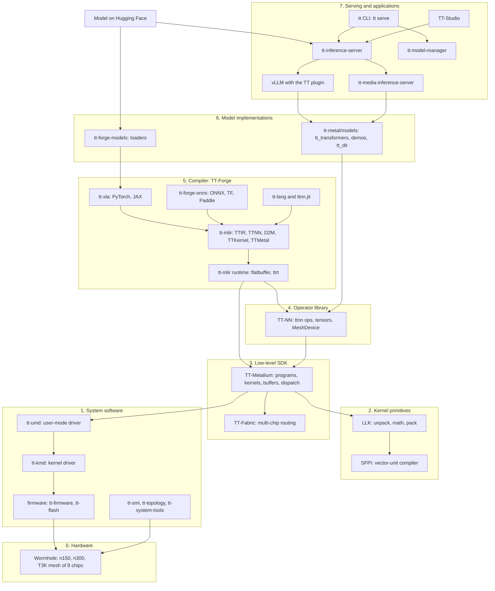
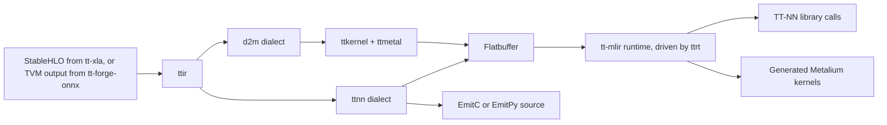

# The Tenstorrent stack: compiler and module hierarchy

This is a map of every layer between a model on Hugging Face and a Tensix core, written for the two people who will bring new models up on the lab's Wormhole boxes. For each layer it says what the layer is, which repository and directory holds it, and when you would change it.

**How to read the claims here.** Unmarked statements were read from Tenstorrent's documentation and repositories on 2026-11-16 (sources in [04-references.md](04-references.md)). Statements marked *(unverified)* come from memory of the code and should be confirmed in the source before you rely on them. The stack changes weekly, so treat paths and names as correct on that date, not permanently.

## 1. The whole stack in one picture

There are two ways down from a model to TT-NN, and they meet there:

- **Hand-written:** a model implementation in `tt-metal/models` calls `ttnn` operations directly. This is how every production LLM in the serving catalog runs.
- **Compiled:** a frontend traces the framework model, `tt-mlir` lowers it, and the runtime calls `ttnn` (or generated Metalium kernels) for you.

Everything below TT-NN is shared by both.

## 2. Layer by layer

### Layer 7: serving and applications

What a lab member touches when they only want an endpoint.

| Component | Repository | What it does |
| --- | --- | --- |
| `tt` CLI | (ships with the Tenstorrent tools) | `tt serve <model>` gives an OpenAI-compatible endpoint in one command. It delegates to tt-inference-server for catalog models and to tt-model-manager for community bundles. `tt serve <model> --dry-run` prints the underlying command. `tt model list` shows what is servable on the detected board. |
| tt-inference-server | `tenstorrent/tt-inference-server` | Manages containers, weight downloads and serving configuration. It is the authoritative list of which models are validated on which hardware. |
| TT-Studio | `tenstorrent/tt-studio` | Web UI over the same catalog. Started with `tt-studio`. |
| tt-model-manager | (CLI `tt-model`) | Packages and serves community model bundles from the Hugging Face Hub: `tt-model pull`, `tt-model serve`, manifest file `tt-model.yaml`. |
| vLLM fork | `tenstorrent/vllm` (branch `dev`) | vLLM with a TT plugin. Serves LLMs by calling model classes that live in tt-metal. |
| tt-media-inference-server | (image in tt-inference-server releases) | The non-LLM serving engine: image, video, audio. |
| TT-Toplike | | Live view of core activity, power and memory traffic. |

**Inside tt-inference-server**, the pieces that matter for bring-up:

- **`run.py`** is the entry point. Flags seen in the docs: `--model`, `--device`, `--device-id`, `--workflow`, `--docker-server` / `--local-server`, `--no-auth`, `--bind-host`, `--service-port`, `--override-docker-image`, `--vllm-override-args` (JSON), `--print-docker-cmd`, `--host-hf-cache`, `--host-weights-dir`, `--tt-metal-home`, `--limit-samples-mode`.
- **Workflows:** `server`, `benchmarks`, `evals`, and `release` (which runs benchmarks, evals and reports in one pass).
- **Device names:** `n150`, `n300`, `t3k` (the Wormhole QuietBox/LoudBox), `galaxy`; Blackhole uses `p100`, `p150`, `p300x2`.
- **MODEL_SPECS:** the catalog itself, a bundled `model_spec.json`. Each entry binds a model to an implementation (for example `tt_transformers`, `qwen3_32b_galaxy`, `forge_vllm_plugin`), a tt-metal commit, a vLLM commit and a container image. A model is accepted by short name or full Hugging Face repo id.
- **Status levels** used in release notes: `EXPERIMENTAL`, `FUNCTIONAL`, `COMPLETE`, `TOP PERF`.
- **Images:** `vllm-tt-metal-src-release-ubuntu-22.04-amd64:<version>-<tt-metal sha>-<vllm sha>` for LLMs; the server refuses images below a minimum version.

When you change this layer: to add a catalog entry for a model the lab brought up, to point an existing implementation at a new checkpoint, or to set chat template, tool-call and reasoning parsers for a new model.

### Layer 6: model implementations

A "supported model" is concretely a directory of Python that builds the network out of `ttnn` calls and loads Hugging Face weights into device tensors.

| Location | Contents |
| --- | --- |
| `tt-metal/models/tt_transformers/` | The parameterized transformer implementation shared by most LLMs (Llama, Qwen, Mistral, Mixtral and others). Attention, RoPE, KV cache, MLP, norms, generation and sampling. `tt/model_config.py` (`ModelArgs`) decides dimensions, RoPE scaling, prefill chunk sizes and per-device settings from the model name. `model_params/` holds per-model parameters. |
| `tt-metal/models/demos/` | One directory per demo that is not covered by the shared code: `llama3_70b_galaxy`, `deepseek_v3`, `audio/whisper`, vision models. |
| `tt-metal/models/common/` | Shared runtime utilities and the prefill/decode runtimes. |
| `tt-metal/models/tt_dit/` | Diffusion transformers: image and video models. |
| `tt-metal/models/experimental/` | The experimental model zoo. |
| `tt-metal/models/docs/` | `model_bring_up.md` and `MODEL_UPDATES.md`. Read both before a native bring-up. |
| `tenstorrent/tt-forge-models` | The compiler path's model library: one `loader.py` per model exposing a `ModelLoader` class (`query_available_variants`, `load_model`, `load_inputs`, optional `load_shard_spec` and `get_mesh_config`). More than 800 variants are tested in CI. |

When you change this layer: this is where almost all native bring-up work (Path C in the [workflow](02-day0-workflow.md)) happens. A new LLM is usually a branch in `model_config.py` plus one or two modified modules, not a new directory.

### Layer 5: the compiler, TT-Forge

TT-Forge is the umbrella name for the MLIR-based compiler stack. It has frontends, a core, and satellites.

**Frontends**

| Frontend | Frameworks | Chips | Mechanism | Status |
| --- | --- | --- | --- | --- |
| **tt-xla** | PyTorch, JAX | single and multi-chip | PJRT plugin. `torch-xla` or `jax.jit` traces the model to a StableHLO graph and hands it to tt-mlir. In PyTorch, `import tt_torch` registers the `"tt"` backend for `torch.compile`; in JAX, `import pjrt_plugin_tt`. | Primary frontend; use for all new PyTorch work. |
| **tt-forge-onnx** | ONNX, TensorFlow, PaddlePaddle | single-chip only | TVM-based; `forge.compile()`. This is the frontend earlier published as tt-forge-fe *(unverified: the rename)*. | Maintained, but being superseded by tt-xla. |
| tt-torch | PyTorch | | | Deprecated in favor of tt-xla. |
| TT-Buda / PyBuda | | | | Deprecated. Do not use. |

**The core: tt-mlir**

tt-mlir is a library of MLIR dialects and passes, plus a runtime. Its dialects, top to bottom:

| Dialect | Level | What it models |
| --- | --- | --- |
| `ttcore` | shared | Common types and attributes: `ttcore.tile`, `ttcore.metal_layout`, `ttcore.grid`, and enums for data formats, memory spaces and iterator types. |
| `ttir` | high | The tensor compute graph as named ops on tensors (`ttir.linear`). The default entry IR; StableHLO, TOSA and linalg are converted into it. |
| `ttnn` | mid | The TT-NN API, nearly one to one (`ttnn.linear`, `ttnn.deallocate`). Lowering to this dialect means "run the model by calling the TT-NN library". |
| `d2m` | mid | "Direct to metal". A generic compute dialect in the style of `linalg.generic`: `d2m.generic`, `d2m.to_layout`, `d2m.tile_matmul`. Lowering here means "generate kernels for this graph" instead of calling library ops. |
| `ttkernel` | low | Device kernels, nearly one to one with the Metalium kernel API: circular buffers (`ttkernel.cb_push_back`), tile registers, NoC transactions (`ttkernel.noc_async_read`), tile math, and `ttkernel.sfpu_*` for the vector unit. |
| `ttmetal` | low | Host/device interop: `ttmetal.create_buffer`, `ttmetal.enqueue_program`, `ttmetal.enqueue_read_buffer`. |

The lowering has two branches after TTIR:

- **TTNN branch (the production path).** TTIR is lowered to the `ttnn` dialect. An optimizer chooses tensor layouts, memory configs and sharding, inserting layout conversions where needed. The result is serialized to a flatbuffer and executed by the runtime, which calls the real TT-NN library. The pipeline is named `ttir-to-ttnn-backend-pipeline` *(unverified: name from memory; check `ttmlir-opt --help`)*.
- **D2M branch (kernel generation).** TTIR is lowered through `d2m` to `ttkernel` and `ttmetal`, producing custom kernels. The pipeline is `ttir-to-ttmetal-pipeline`. In `ttnn-mode` it wraps the generated kernels in `ttnn.generic` ops so they can sit inside an ordinary TT-NN graph. Today it fuses elementwise ops; reductions, matmuls and tensor manipulations are not yet fusable.
- **Source emission.** EmitC produces standalone C++ against TT-NN (the `ttnn-standalone` flow) and EmitPy produces Python. Both are useful for turning a compiled model into code you can read and hand-tune.

Tools and internals in the tt-mlir repository:

| Name | Purpose |
| --- | --- |
| `ttmlir-opt` | Runs passes and pipelines on MLIR text. The tool for reproducing a compile failure outside the frontend. |
| `ttmlir-translate` | Converts MLIR to flatbuffer or emitted source. |
| `ttrt` | Runtime CLI. Runs a flatbuffer on a device; `ttrt query --save-artifacts` writes the system descriptor that describes the attached hardware to the compiler. |
| `tt-explorer` | Graph and performance visualizer built on Model Explorer. |
| `tt-alchemist` | Tool for turning compiled models into standalone code *(unverified: exact scope)*. |
| `ttir-builder`, `stablehlo-builder` | Python builders for constructing test graphs op by op. |
| Optimizer | Chooses layouts, memory configs and sharding for the TTNN branch. |
| PyKernel | Python front end for writing kernels that compile through `ttkernel`. |
| `ttnn.jit` | `@ttnn_jit.jit()` decorator. Traces a function of `ttnn` calls into TTIR, runs the D2M pipeline, and replaces the calls with one fused kernel. Flags include `math_fidelity`, `enable_cache`, `memory_config`, `fallback`. Source build only for now. |

Repository layout of `tenstorrent/tt-mlir`:

| Path | Contents |
| --- | --- |
| `env/` | Builds the toolchain dependencies (LLVM, Flatbuffers). |
| `include/ttmlir/Dialect/<Name>/IR` | Op, type and attribute definitions per dialect. |
| `include/ttmlir/Dialect/<Name>/Passes.{h,td}` and `Transforms` | Pass declarations and shared transformations. |
| `include/ttmlir/Target/` | Flatbuffer schemas: the binary interface between compiler and runtime. |
| `lib/Dialect/` | Dialect implementations. Conversions between dialects live under `lib/Conversion/` *(unverified: path)*. |
| `lib/CAPI/` | C API, used by the Python bindings. |
| `runtime/include/tt/runtime`, `runtime/lib` | The device runtime. |
| `runtime/tools/python` | Python bindings for the runtime; `ttrt` is here. |
| `tools/ttmlir-opt` | The optimizer driver. |
| `test/` | Lit and runtime tests. |

**Satellites**

| Project | Role |
| --- | --- |
| **tt-lang** | A Python DSL for custom operations, positioned between TT-NN and TT-Metalium. You write explicit data movement plus a high-level compute description; the compiler infers compute API calls, NoC addressing and destination-register allocation. Includes a functional simulator and line-level profiling. Main use: kernel fusion as a drop-in replacement inside a TT-NN graph. Early preview. |
| **tt-forge-models** | The model loader library used by the frontends' test suites. |
| **tt-blacksmith** | Training recipes (PyTorch, JAX, Lightning). |

**The compiler's own test harness.** tt-xla contains a model test runner that is directly useful for day-0 work. It scans `third_party/tt_forge_models/**/pytorch/loader.py`, generates a test per variant, run mode (`inference`, `training`) and parallelism (`single_device`, `data_parallel`, `tensor_parallel`), and records a `bringup_status` for each: `PASSED`, `INCORRECT_RESULT`, `FAILED_FE_COMPILATION`, `FAILED_TTMLIR_COMPILATION`, `FAILED_RUNTIME`, `NOT_STARTED`, `UNKNOWN`. Expected outcomes live in `tests/runner/test_config/*.yaml` with a `required_pcc` per test. The multi-chip Wormhole system is selected with `--arch n300-llmbox`. Those failure buckets tell you which layer a new model breaks in.

When you change this layer: to add a missing op lowering (StableHLO to TTIR, or TTIR to TTNN), to fix a decomposition, to teach the optimizer a layout, or to add a model loader.

### Layer 4: TT-NN, the operator library

A PyTorch-like library of operations in Python and C++, built on Metalium. It is the meeting point of the hand-written and compiled paths.

| Path in `tt-metal` | Contents |
| --- | --- |
| `ttnn/api/ttnn/` | Public headers. |
| `ttnn/core/` | Tensor handling, graph processing. |
| `ttnn/cpp/ttnn/operations/` | The operations, grouped by family (arithmetic, convolution, attention, experimental, CCL and so on). |
| `ttnn/cpp/ttnn-nanobind/` | Python bindings. |
| `tests/ttnn/unit_tests/` | Per-op tests; the fastest way to see how an op is meant to be called. |

Concepts you must hold in your head:

- **Tensor = data + layout + dtype + memory config.** Layout is `ROW_MAJOR` or `TILE` (32x32 tiles). Dtype is `bfloat16`, `bfloat8_b`, `bfloat4_b`, or integer and float32 types. Memory config says DRAM or L1, and interleaved or sharded (height, width or block) across a core grid.
- **An operation is three things:** a device operation (validation, output shape, choice of implementation), one or more **program factories** (host code that builds the Metalium program: which cores, which circular buffers, which kernels, which runtime arguments), and the **kernels** themselves. Reading an existing op's program factory is the best tutorial for writing one.
- **Math fidelity** (`LoFi`, `HiFi2`, `HiFi3`, `HiFi4`) is a separate setting from dtype. It controls how many passes the matrix engine makes over the operands. Lower fidelity is faster and less accurate. The two are tuned together.
- **`MeshDevice`** presents several chips as one device. A tensor can be replicated or sharded across the mesh; CCL ops (`all_gather`, `reduce_scatter`, `all_reduce`, `broadcast`) move data between chips.
- **Program cache and trace.** Programs are compiled once and cached by op and tensor attributes. Metal Trace records a whole forward pass and replays it without host dispatch.

When you change this layer: a model needs an op that does not exist, an existing op lacks a memory config or shape the model needs, or profiling shows that a sequence of ops should be one fused op.

### Layer 3: TT-Metalium, the low-level SDK

The host API and device runtime. Everything above compiles down to Metalium programs.

| Path in `tt-metal` | Contents |
| --- | --- |
| `tt_metal/api/tt-metalium/` | Public host API headers. |
| `tt_metal/impl/` | Runtime implementation: devices (`impl/device/`), buffers, allocator, programs, dispatch. |
| `tt_metal/jit_build/` | Just-in-time kernel build: invokes the RISC-V toolchain and caches the binaries. |
| `tt_metal/hw/` | Firmware source, register headers, the kernel-side headers. |
| `tt_metal/llrt/` | Low-level runtime: hardware abstraction layer, register-level access. |
| `tt_metal/fabric/` | TT-Fabric: Ethernet routing between chips, control plane. |
| `tt_metal/distributed/` | Mesh and multi-host execution. |
| `tt_metal/programming_examples/` | The six worked examples, from DRAM loopback to optimized multi-core matmul. |
| `tech_reports/` | The design documents; see the list in [04-references.md](04-references.md). |

The model:

- **Host side.** A program is built from a device (or mesh device), buffers in DRAM or L1, circular buffer configurations, and kernels created with `CreateKernel`, then enqueued on a command queue.
- **Device side.** Each Tensix core has five small RISC-V processors. Two run data-movement kernels (BRISC and NCRISC, one per NoC); three run the compute kernel as unpack, math and pack stages (TRISC0, TRISC1, TRISC2). You write one compute kernel; the build splits it across the three.
- **Circular buffers** in L1 connect the kernels on a core. Producer: `cb_reserve_back`, write, `cb_push_back`. Consumer: `cb_wait_front`, read, `cb_pop_front`.
- **Data movement API:** `noc_async_read`, `noc_async_write`, their barriers, multicast writes, and semaphores for cross-core synchronization.
- **Compute API:** tile operations on the matrix engine (`matmul_tiles`, `add_tiles`, `reduce_tile`, ...) and on the vector unit (`exp`, `sqrt`, `recip`, `gelu`, ...), bracketed by the `tile_regs_acquire` / `commit` / `wait` / `release` calls.
- **Kernels are compiled on the host at first use** and cached. This is why a first run is slow.
- **Dispatch.** Commands go from the host over PCIe to dispatch cores on the chip, which program the worker cores. On an n300 only the first chip is on PCIe; the second is reached over Ethernet.

When you change this layer: you are writing a new op's kernels, or tuning how an existing op moves data (multicast, data reuse, sharding).

### Layer 2: LLK and SFPI

The primitives that the compute API is made of.

- **LLK (low-level kernels)** are header-only C++ routines implementing unpack, math and pack for each architecture. They live inside tt-metal (for Wormhole under `tt_metal/hw/ckernels/wormhole_b0/metal/llk_api/`, with files named `llk_unpack_*.h`, `llk_math_*.h`, `llk_pack_api.h`). The standalone `tenstorrent/tt-llk` repository is frozen; its documentation is still the best written introduction.
- **SFPI** is the programming interface and compiler support for the vector unit (SFPU): a 32-lane SIMD engine with eight local registers, no spilling, everything inlined. A missing elementwise function (a new activation, for example) is written here. Repository: `tenstorrent/sfpi`.

When you change this layer: a model needs a pointwise function the vector unit does not have, or a format conversion in unpack or pack is missing. This is rare, and it is the layer where the hardware manual (`tenstorrent/tt-isa-documentation`) becomes required reading.

### Layer 1: system software

| Component | Role |
| --- | --- |
| `tt-umd` | User-mode driver: memory-maps the device, implements host-to-chip transport over PCIe and Ethernet. Vendored into tt-metal as a third-party dependency. |
| `tt-kmd` | Linux kernel driver (DKMS). Creates `/dev/tenstorrent/N`. |
| Firmware | Shipped as bundles in `tt-firmware`, written with `tt-flash`. |
| `tt-smi` | Board status, telemetry, resets. First thing to run when anything fails. |
| `tt-topology` | Configures the mesh layout across cards. |
| `tt-system-tools` | Hugepages setup and related services. |
| `tt-installer` | Installs all of the above in one script. |
| `tt-exalens` | Low-level debugger for a hung or misbehaving chip. |

These three must be on mutually compatible versions: driver, firmware, and the tt-metal release. A mismatch produces failures that look like software bugs higher up.

### Layer 0: the hardware you have

- **Chip.** One Wormhole has a 10x12 grid of tiles, of which 80 are Tensix compute tiles; shipping boards expose about 64 after harvesting. Each Tensix has about 1.5 MB of L1 SRAM. Each chip has 12 GB of GDDR6.
- **n300.** Two chips on one card, 24 GB. Only the first is on PCIe.
- **QuietBox / LoudBox (T3000, "T3K").** Four n300 cards: eight chips in a 2x4 Ethernet mesh, 96 GB of device DRAM in total. Tools call it `t3k` (tt-inference-server) or `n300-llmbox` (tt-xla).

The memory ceiling is the one hard constraint on "every model". As a rough guide, weights need about 2 bytes per parameter in `bfloat16` and about 1 byte in `bfloat8_b`, before KV cache and activations. Qwen 2.5 72B and Llama 3.3 70B run on the eight-chip box with tensor parallelism across all eight; a dense model much beyond that size does not fit.

## 3. What one request touches on the way down

**Served LLM (hand-written path).**

1. An HTTP request reaches the vLLM server in the `vllm-tt-metal` container.
2. The TT plugin calls the model's generator in `tt-metal/models/tt_transformers`: prefill for the prompt, then decode per token.
3. Each layer calls `ttnn` ops on a `MeshDevice`.
4. Each op's device operation picks a program factory, which builds (or fetches from cache) a Metalium program.
5. On first use the program's kernels are compiled for RISC-V and cached.
6. The command queue sends the program to the dispatch cores, which start the worker cores.
7. On each worker core the reader kernel pulls tiles over the NoC into circular buffers, the compute kernel runs LLK routines on them, the writer kernel pushes results out.
8. Between chips, CCL ops move tensors over Ethernet through TT-Fabric.
9. Logits come back to the host; vLLM samples and streams the token.

**Compiled model (compiler path).**

1. `torch.compile(model, backend="tt")` registers the model; nothing compiles yet.
2. The first forward pass traces the model to StableHLO and hands it to the tt-xla PJRT plugin.
3. tt-mlir converts StableHLO to `ttir`, lowers to the `ttnn` dialect, and the optimizer assigns layouts and memory configs.
4. The result is serialized to a flatbuffer; the runtime executes it by calling the TT-NN library.
5. From step 3 of the list above, the two paths are identical.
6. The second pass captures a runtime trace; from the third pass on you are at steady state.

## 4. Where to make a change

| What you see | Layer | Where to look |
| --- | --- | --- |
| Fewer than eight chips, mesh errors | 1 | `tt-smi`, cabling, `tt-topology`, driver and firmware versions |
| Model not in `tt model list` | 7 | `model_spec.json` in tt-inference-server; try the Hugging Face repo id; otherwise Path B or C |
| `Image vX is not supported (need vY+)` | 7 | tt-inference-server tag versus the model's pin |
| Unknown config field or wrong shapes for a new checkpoint | 6 | `models/tt_transformers/tt/model_config.py` |
| `FAILED_FE_COMPILATION` | 5 | tt-xla frontend: the trace to StableHLO failed (unsupported PyTorch construct) |
| `FAILED_TTMLIR_COMPILATION` | 5 | tt-mlir: a StableHLO or TTIR op has no lowering; reproduce with `ttmlir-opt` |
| `FAILED_RUNTIME` | 4 or 3 | A `ttnn` op rejected its inputs, ran out of memory, or hung; rerun the single op from the flatbuffer with `ttrt` |
| `INCORRECT_RESULT` (PCC below threshold) | 4 or 2 | Dtype or fidelity too low, or an op bug; bisect by module |
| Correct but slow, one op dominates | 4 and 3 | The op's program factory and kernels; sharding; fused op via `ttnn.jit`, tt-lang or hand-written Metalium |
| Correct but slow, no op dominates | 4 | Host dispatch overhead: Metal Trace and a second command queue |
| Missing pointwise function | 2 | SFPI |
| Hang | 3 | Watcher, DPRINT, `tt-exalens` |

## 5. Deprecated, so you can ignore it when it shows up in search results

- **TT-Buda / PyBuda** (`tt-buda`, `tt-budabackend`, `tt-buda-demos`): replaced by TT-Forge.
- **tt-torch:** replaced by tt-xla.
- **Standalone `tt-llk` repository:** frozen; development moved into tt-metal.
- **Grayskull:** first-generation hardware, no longer supported by current releases *(unverified: which release dropped it)*.
- **`acquire_dst` / `release_dst`** in kernels: replaced by the `tile_regs_*` family.
