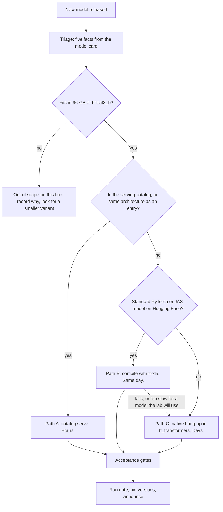

# Day-0 workflow: a new model has been released

The runbook for getting a newly released model running on a Wormhole box (QuietBox or LoudBox, eight chips, `t3k`) the same day. It assumes the standing baseline in section 2 is already in place. Layer names refer to [01-stack-hierarchy.md](01-stack-hierarchy.md).

## 1. Pick a path in the first hour

Every model takes one of three paths. They are a ladder: start at A, drop to B when A has no entry, invest in C only when the model matters and A and B leave it broken or slow.



| Path | Use when | What you get | Typical time |
| --- | --- | --- | --- |
| **A. Catalog serve** | The model, or a checkpoint of the same architecture, is in tt-inference-server's catalog for `t3k`, `n300` or `n150` | OpenAI-compatible endpoint at the catalog's validated performance | Hours, mostly download and first-run compile |
| **B. Compiler** | Not in the catalog, but an ordinary Hugging Face PyTorch or JAX model | The model running on device with a PCC check and a list of whatever failed. Performance is whatever the compiler produces | Same day when it compiles; otherwise you leave with a precise failure bucket |
| **C. Native** | A new architecture the lab wants in regular use, or B is broken or far too slow | Production throughput, served through vLLM | Days for a variant of a supported family; weeks for a new family |

## 2. Standing baseline

Day-0 speed depends on none of this being done on the day.

- **Driver, firmware and tt-metal on compatible versions**, identical on both boxes. `tt-smi` shows eight healthy chips. Run `tt-smi` first for any "it won't run" report.
- **Docker, and a clone of `tt-inference-server`** with tags fetched weekly. The catalog and the minimum image version both move.
- **A source build of `tt-metal`** with submodules (`git clone --recurse-submodules`, `./build_metal.sh`), `TT_METAL_HOME` and `PYTHONPATH` exported, CPU governor set to `performance` on the box used for measurements.
- **A separate tt-xla environment.** Install the PJRT plugin in its own virtual environment:

  ```bash
  python3 -m venv ~/.venvs/forge && source ~/.venvs/forge/bin/activate
  pip install pjrt-plugin-tt --extra-index-url https://pypi.eng.aws.tenstorrent.com/
  python3 -c "import jax; print(jax.devices('tt'))"
  ```

  In that shell `TT_METAL_HOME` and `LD_LIBRARY_PATH` must be unset. Crossing the two environments is the most common silent failure.
- **Hugging Face access arranged in advance.** `HF_TOKEN` exported from a lab account that has already requested access to the gated families (Llama, Gemma, Mistral and so on). Approval is the model owner's decision and can take days.
- **One shared weights cache** (`HF_HOME` on shared NVMe) so a 70B download happens once.
- **Named owners:** one person for the baseline, one for the current bring-up.

## 3. Step 1: triage

Read the model card and write down five facts in [`templates/triage.md`](../templates/triage.md).

| Fact | Why it matters |
| --- | --- |
| **Architecture and family** | Llama-like, a known family, or new (new attention variant, MoE routing, state-space, diffusion LM)? A known family is one config branch away from supported. |
| **Modality** | LLM and VLM go through vLLM. Image, video and audio go through the media server. Embedding and vision models can go through the Forge vLLM plugin. |
| **Size** | Parameters x 1 byte (`bfloat8_b`) or x 2 bytes (`bfloat16`), plus KV cache. Against 12 GB per chip, 24 GB per n300, 96 GB per box. Decides the mesh and whether the model is in scope at all. |
| **License and gating** | If gated, request access immediately. |
| **Unusual operations** | RoPE variants, sliding-window attention, custom norms, MoE, cross-attention to a vision tower. These are the items a native bring-up has to special-case. |

Then check what exists, in this order:

1. **Serving catalog.** `tt model list`, or `docs/model_support/models_by_hardware.md` in tt-inference-server (the Wormhole LoudBox/QuietBox table). Try both the short name and the full Hugging Face repo id.
2. **Same architecture already implemented.** `ls models/tt_transformers/model_params/` and `models/demos/` in tt-metal.
3. **Compiler model library.** Is there a loader in `tt-forge-models`, and what status does tt-xla's test config give it?
4. **Upstream issue tracker.** Search tt-metal and tt-inference-server issues for the model name; the work may be in progress or carry a bounty.

## 4. Path A: catalog serve

1. **Find the pin.** The catalog entry names a container image, a tt-metal commit and a vLLM commit. Check out the tt-inference-server tag that satisfies it: `git fetch --tags`, then the highest `v` tag at or above the pin.
2. **Print the command before running it:** `tt serve <model> --dry-run`, or `--print-docker-cmd` on `run.py`.
3. **Launch.**

   ```bash
   export HF_TOKEN=...
   python3 run.py --model <model> --device t3k --workflow server --docker-server
   ```

   The first start of a 70B model can take up to about 40 minutes for weight transfer and kernel compilation. Later starts use the cache.
4. **Smoke test** the endpoint on its service port, and watch `tt-smi` or TT-Toplike to confirm the chips are working.
5. **Measure** with the built-in workflows on the same model: `--workflow benchmarks`, `--workflow evals`, or `--workflow release` for all of them.

**Stretching Path A to a model that is not listed.** A new fine-tune or size of a supported architecture often runs through the existing implementation:

- pass the full Hugging Face repo id;
- or run vLLM directly on the host against the tt-metal model class, bypassing MODEL_SPECS (the TT plugin README in `tenstorrent/vllm` describes the setup);
- when staying inside `run.py`, `--vllm-override-args` (JSON) changes context length and parsers, and `--local-server` with `--tt-metal-home` runs against your own tt-metal build instead of the container.

If it fails on an unknown config field or a shape mismatch, the architecture differs and you are on Path C, usually a small one.

## 5. Path B: compile with tt-xla

Choose the frontend by source framework: PyTorch or JAX use **tt-xla**; ONNX, TensorFlow or PaddlePaddle use **tt-forge-onnx** (single chip only).

```python
import torch, tt_torch
from transformers import AutoModelForCausalLM

model = AutoModelForCausalLM.from_pretrained(model_id, torch_dtype=torch.bfloat16)
model = model.to(dtype=torch.bfloat16).eval()   # cast before compiling
compiled = torch.compile(model, backend="tt")
```

Things that go wrong on the day:

- **Compilation happens on the first forward pass.** Pass 1 compiles, transfers weights and builds kernels. Pass 2 captures a runtime trace. Pass 3 onward is steady state. Warm up at least three passes before timing anything.
- **Cast to `bfloat16` first.** `bfloat8_b` is a compile option to try afterwards, once accuracy on your workload is confirmed.
- **Failures arrive in buckets,** and the bucket names the layer.

| Bucket | Meaning | Next step |
| --- | --- | --- |
| `FAILED_FE_COMPILATION` | Tracing to StableHLO failed | Simplify or rewrite the offending PyTorch construct; check for dynamic control flow |
| `FAILED_TTMLIR_COMPILATION` | An op has no lowering in tt-mlir | Reproduce with `ttmlir-opt`; add a decomposition or lowering, or work around in the model |
| `FAILED_RUNTIME` | A TT-NN op rejected its inputs, ran out of memory, or hung | Rerun from the flatbuffer with `ttrt`; this is a Layer 4 or 3 problem |
| `INCORRECT_RESULT` | PCC below threshold | Bisect by submodule; try `bfloat16` and higher fidelity |

**Use the existing harness rather than a one-off script** when the model will be kept. Add a `loader.py` to tt-forge-models, then:

```bash
pytest --collect-only -q tests/runner/test_models.py -k "<model>"
pytest -vv "tests/runner/test_models.py::test_all_models[<node-id>]" --arch n300-llmbox
```

Path B produces a running baseline, a correctness reference, and an exact list of gaps. For research use that is often the finished state. For a model the lab will serve, it is the specification for Path C.

## 6. Path C: native bring-up in tt_transformers

Read `models/docs/model_bring_up.md` in tt-metal first; it is the upstream process and this section follows it.

**Reuse, do not rewrite.** `tt_transformers` is a parameterized reference implementation. A new LLM is almost always a modification of the closest existing family.

1. **Map the differences.** Diff the Hugging Face config and modeling file against the closest supported model. List every difference: RoPE scaling, norm type and placement, attention variant, MoE routing, activation, tokenizer and chat template. Each is a task.
2. **Bring up one module at a time**, each with a PCC test against the Hugging Face reference:
   1. norms;
   2. attention, including RoPE and the KV cache;
   3. MLP, or gate plus experts for MoE;
   4. one decoder block;
   5. the full model in decode mode;
   6. prefill, with `min_prefill_chunk_size` set conservatively at first.
3. **Add the model to `model_config.py`** with a detection branch for its name: dimensions, RoPE scaling, chunk sizes, per-device memory configs.
4. **Run the full model** and check end-to-end PCC on logits, then generated text on a few prompts.
5. **Profile, then optimize** (section 8). Write a custom op or kernel only for an operation the profile shows is dominant.
6. **Serve it.** Wire the model into the vLLM plugin, set chat template, tool-call and reasoning parsers, and add a MODEL_SPECS entry in the lab's fork of tt-inference-server.

## 7. Step 3: acceptance gates

The same gates apply whichever path produced the model. Record the numbers in the run note.

| Gate | Pass condition |
| --- | --- |
| **1. Correctness** | PCC of at least 0.99 on final logits against the CPU reference, per module during a native bring-up. Plus a read of generated text on a few prompts, because tokenizer, padding and RoPE bugs can pass PCC at short lengths. |
| **2. Throughput** | Tokens per second per user and total, at the target batch, after warm-up. Compare with the published figure for the closest catalog model. Lab bar: 25% of that reference to call it usable, 50% to call it good. |
| **3. Context and concurrency** | The claimed context length and number of concurrent users both hold on the box. Long context and high batch are where memory configs fail first. |
| **4. Stability** | Sustained load for at least ten minutes with no hang. A decode loop that is right for ten tokens and wrong at two thousand is a known failure class. |

Measure on a warmed model with the `performance` governor. Discard the first two iterations.

## 8. Step 4: performance and scale-out

**Profile first.**

- **Tracy** for the host and device timeline.
- **Device program profiler** for per-core, per-processor zones inside kernels.
- **TT-NN Visualizer** and **tt-explorer** for per-op time across the graph.
- **Watcher**, **DPRINT** and **tt-exalens** for hangs.

**Single-chip levers, in a reasonable order to try:**

1. **Metal Trace and a second command queue.** Removes host dispatch overhead. Largest effect on decode and on graphs of many small ops.
2. **Dtype and math fidelity.** `bfloat8_b` or `bfloat4_b` weights with the lowest fidelity that still passes Gate 1. These are two separate settings. `fp32_dest_acc_en` improves accuracy and halves destination-register capacity.
3. **Sharding.** Keep hot tensors in L1 next to the cores that consume them; choose height, width or block sharding to match the op.
4. **Matmul program configs.** Data reuse and multicast; blocked matmul.
5. **Fusion.** Replace a chain of small ops with one kernel using `ttnn.jit`, tt-lang, or a hand-written TT-NN op.

**Across the eight-chip mesh:**

- Use a `MeshDevice`. Large models are tensor-parallel across all eight chips; small models are data-parallel for throughput.
- Cross-chip traffic goes through CCL ops over TT-Fabric. Ethernet links are the scarce resource; measure collective bandwidth and do not assume linear scaling.

Stop when the dominant op is near its limit, compute-bound on the matrix engine or memory-bound on DRAM and NoC bandwidth, by comparison with the achieved figures in the `GEMM_FLOPS` tech report.

## 9. Step 5: publish

- **Pin everything:** tt-metal commit, tt-inference-server tag, vLLM commit, image digest, firmware and driver versions, environment variables.
- **Write the run note** from [`templates/run-note.md`](../templates/run-note.md) and commit it under `runs/`.
- **Update** [`tracking/model-matrix.md`](../tracking/model-matrix.md).
- **Make it one command for everyone else:** a MODEL_SPECS entry in the lab fork, or a `tt-model.yaml` bundle.
- **Announce** the endpoint, which chips it occupies, and its limits.
- **Send it upstream** when it is general: a loader to tt-forge-models, a test config entry to tt-xla, a model branch to tt-metal.

## 10. Troubleshooting

| Symptom | Likely cause and fix |
| --- | --- |
| `Image vX is not supported (need vY+)` | tt-inference-server checkout is older than the model's pin. Check out the right tag. |
| Fewer than eight chips, or mesh ops fail | Cabling between cards, topology, or driver and firmware mismatch. `tt-smi`, then `tt-topology`. |
| Model name not found | Try the full Hugging Face repo id; otherwise it is not in the catalog. |
| Unknown config field, or shape mismatch on a new checkpoint | The architecture differs. Add a branch in `model_config.py`. |
| First request takes tens of minutes | Cold cache: weight transfer and kernel compilation. Expected once. |
| Import or library errors in the compiler environment | tt-metal variables leaked in. `unset TT_METAL_HOME LD_LIBRARY_PATH`. |
| Good numbers, bad output | Timing included warm-up, or PCC was never checked. Rerun Gate 1 per module. |
| Right for short prompts, wrong or hung for long ones | Prefill chunking or KV-cache handling. Lower the chunk size; enable Watcher. |
| Out of memory at load | Weights do not fit at this dtype. Use `bfloat8_b`, more chips, or a smaller variant. |
| Out of memory during prefill | Activations at long sequence length. Reduce prefill chunk size or context. |

## 11. Environment reference

```bash
# tt-metal, tt_transformers, vLLM
export TT_METAL_HOME=~/tt-metal
export PYTHONPATH=$TT_METAL_HOME:$PYTHONPATH
export HF_TOKEN=<token>
export HF_HOME=/shared/hf-cache
export VLLM_TARGET_DEVICE=tt
export VLLM_RPC_TIMEOUT=900000

# tt-xla / TT-Forge: a separate shell
unset TT_METAL_HOME
unset LD_LIBRARY_PATH
source ~/.venvs/forge/bin/activate
```
