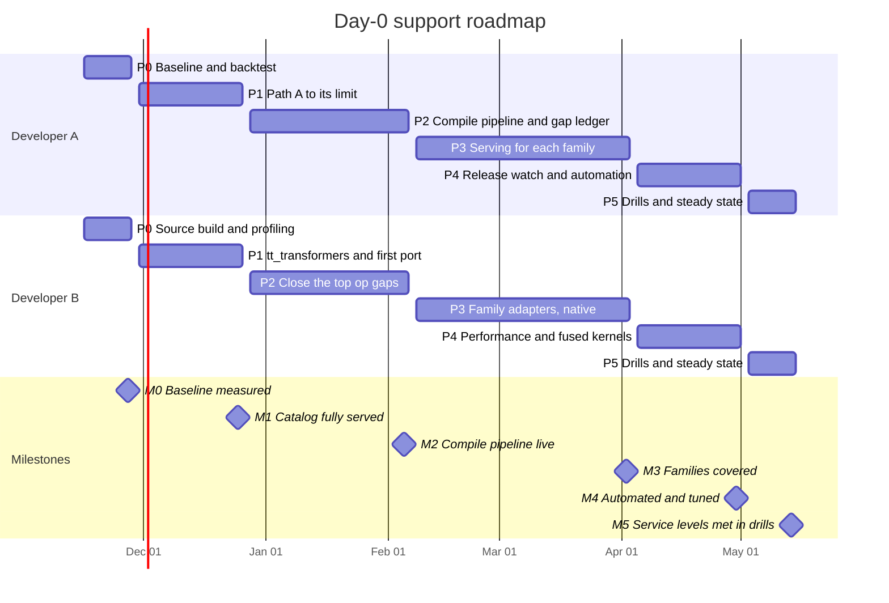

# Roadmap: day-0 model support on Wormhole with two developers

A 26-week plan, 2026-11-16 to 2027-05-14, that takes the lab from "we can serve what Tenstorrent has already validated" to "a new model release is running on a box within a day, by a rehearsed process". Layer numbers refer to [01-stack-hierarchy.md](01-stack-hierarchy.md); Paths A, B and C are defined in [02-day0-workflow.md](02-day0-workflow.md).

**Planning assumption.** Each developer gives this about half of their working week. If the real figure is lower, stretch the dates and keep the order. Weeks 6 and 7 fall on the winter holidays and are planned light.

## 1. What "all models, day 0" means here

Two developers cannot make every model fast on the day it ships, and some models cannot run on this hardware at all. The goal is therefore stated as service levels over classes of model, so that it can be measured.

**Service levels**

| Clock | Commitment |
| --- | --- |
| Release + 4 hours | Triage note filed: class, path, blockers. If the model is out of scope, that is stated with the reason. |
| Release + 24 hours | The model produces correct output on a box (Gate 1 passed) by some path. |
| Release + 72 hours | For LLMs, VLMs and embedding models: an OpenAI-compatible endpoint the lab can call. |
| Release + 14 days | For models the lab adopts: native implementation at 25% or more of the reference throughput for the closest catalog model. |

**Classes**

| Class | Definition | Expected route | Target |
| --- | --- | --- | --- |
| **1. Sibling** | Same architecture as a catalog or `tt_transformers` model: new size, fine-tune, or version | Path A, sometimes a config branch | Same day |
| **2. Compilable** | Standard Hugging Face model, fits in memory, every op has a lowering | Path B | Same day |
| **3. Gap** | Needs a new op, a new lowering, or a new architectural feature | Path B to locate the gap, then Path C or a compiler fix | Days; the 24-hour level is met only when a workaround exists |
| **4. Out of scope** | Does not fit in 96 GB at `bfloat8_b`, or depends on something Wormhole does not have | None | Declared within 4 hours, with the nearest variant that does fit |

"All models" in this plan means classes 1 to 3. The plan's job is to move as many releases as possible from class 3 into classes 1 and 2 **before** they are released, by building support for architecture families ahead of time.

The current hit rate is unknown. Measuring it is the first deliverable (the backtest in Phase 0), and it is re-measured at every milestone.

## 2. The two roles

The split follows the stack: one developer owns the top half, the other the bottom half, and they meet at TT-NN.

| | **Developer A: serving and coverage** | **Developer B: kernels and performance** |
| --- | --- | --- |
| Layers | 7, 6 (serving side), 5 | 6 (model code), 4, 3, 2 |
| Owns | Release watch and triage, tt-inference-server and vLLM, tt-xla and tt-mlir bring-up, the test harness, the coverage matrix, automation | `tt_transformers` and native bring-ups, TT-NN ops, Metalium kernels, profiling, mesh and CCL performance |
| Primary box | The box kept on the pinned serving stack | The box used for source builds and compiler work |
| First-hour job on a release | Triage, catalog check, Path A or B attempt | Read the modeling code, list architectural differences, estimate Path C |
| Background needed | Docker, vLLM, PyTorch, MLIR basics | C++, the Metalium kernel model, profiling |

Shared by both: the weekly stack uplift, review of each other's changes, the on-call rota for releases (alternating weeks from Phase 4), and the drills.

Each developer should be able to do the other's first-hour job. The cross-training tasks below are there for that reason; with two people, any week one is away the other covers both.

## 3. Timeline

| Phase | Weeks | Dates | Outcome |
| --- | --- | --- | --- |
| 0. Baseline | 1 to 2 | 2026-11-16 to 2026-11-27 | Both boxes identical and pinned; current hit rate measured |
| 1. Path A to its limit | 3 to 6 | 2026-11-30 to 2026-12-25 | Every catalog model for this hardware served and measured; first native port done |
| 2. Compile pipeline | 7 to 12 | 2026-12-28 to 2027-02-05 | One command takes a Hugging Face id to a pass or a failure bucket; top gaps closed |
| 3. Architecture families | 13 to 20 | 2027-02-08 to 2027-04-02 | A native reference and a serving recipe for each family, ahead of releases |
| 4. Automation and performance | 21 to 24 | 2027-04-05 to 2027-04-30 | Release watch runs unattended; adopted models at 50% of reference |
| 5. Drills and steady state | 25 to 26 | 2027-05-03 to 2027-05-14 | Service levels demonstrated on real releases; operating cadence set |

## 4. Phases in detail

### Phase 0: baseline (weeks 1 to 2, to 2026-11-27)

Purpose: know exactly where the lab stands before building anything.

**Developer A**

- Bring both boxes to one pinned stack: driver, firmware, tt-metal release, tt-inference-server tag. Write the versions into `tracking/stack-pins.md`.
- Write `scripts/preflight.sh`: eight chips in `tt-smi`, hugepages, Docker, `HF_TOKEN`, free disk, shared cache mounted.
- Serve three reference models through Path A on `t3k` and record all four gates: Llama-3.1-8B-Instruct, one 70B-class model, one non-LLM (Whisper).
- **Backtest.** List the 20 most significant open-weight releases of the past six months. For each, record the class it would have fallen in and which path would have worked on its release date. This is the baseline hit rate.

**Developer B**

- Build tt-metal from source on the second box; run the six programming examples and the matmul labs.
- Run the `tt_transformers` demo for Llama-3.1-8B from source (no container) and match Developer A's container numbers.
- Capture a Tracy profile and a device-profiler trace of one decode step; write a one-page reading of where the time goes.
- Set up the tt-xla environment in isolation and compile one small model.

**Both:** request access to every gated family on the lab Hugging Face account.

**Exit criteria (M0)**

- [ ] Preflight passes on both boxes
- [ ] Three reference models served with gate numbers recorded
- [ ] Backtest table filled; baseline hit rate stated per service level
- [ ] Source build reproduces container throughput within 10%

### Phase 1: Path A to its limit (weeks 3 to 6, to 2026-12-25)

Purpose: extract everything the existing catalog and implementations can give, and learn the native code by doing one port.

**Developer A**

- Serve every catalog entry that lists `t3k`, `n300` or `n150`; fill the matrix with measured gates.
- Find the boundary of the sibling trick: for each supported architecture, try three unlisted checkpoints (a fine-tune, another size, a newer version) and record what breaks.
- Document the host vLLM route that bypasses MODEL_SPECS, including chat template, tool-call parser and reasoning parser settings.
- Fork tt-inference-server for the lab; add the first lab-authored MODEL_SPECS entry.
- Stand up one always-on lab endpoint and a short usage page.
- Write `scripts/d0-serve.sh`: catalog check, pin check, launch, smoke test, benchmark, run-note skeleton.

**Developer B**

- Read `tt_transformers` end to end. Write `docs/notes/tt-transformers-map.md`: what `ModelArgs` parameterizes, where each architectural choice is made, which modules are shared.
- **First native port:** take one class-1 model that failed Developer A's sibling test and bring it up by the Path C steps, with a PCC test per module.
- Write the module PCC test scaffold so the next port starts from a template.

**Cross-training:** Developer B serves one model through Path A alone. Developer A runs one module PCC test alone.

**Exit criteria (M1)**

- [ ] Matrix has measured gates for every catalog model on this hardware
- [ ] Sibling boundary documented per architecture
- [ ] One native port merged in the lab fork, passing all four gates
- [ ] Lab endpoint in use by at least one person outside this project

### Phase 2: the compile pipeline (weeks 7 to 12, to 2027-02-05)

Purpose: make Path B a single command, and use it to find out which gaps matter.

**Developer A**

- Run tt-xla's model test runner against the eight-chip box (`--arch n300-llmbox`) for a chosen set of about 50 models spanning every family in section 5.
- Build `d0-compile`: Hugging Face id in; loader generated or reused; compile; PCC; result classified as `PASSED`, `INCORRECT_RESULT`, `FAILED_FE_COMPILATION`, `FAILED_TTMLIR_COMPILATION` or `FAILED_RUNTIME`, with the failing op named.
- Keep the **gap ledger** (`tracking/gap-ledger.md`): every failing op or construct, how many models it blocks, and its layer. Sort by models blocked.
- Re-run the backtest with the pipeline; record the new hit rate.
- Contribute the first loaders to tt-forge-models.

**Developer B**

- Take the top of the gap ledger each week. For each gap choose the cheapest fix: a decomposition or lowering in tt-mlir, a new or extended TT-NN op, or a rewrite in the model.
- Learn the tt-mlir workflow well enough to reproduce a failure with `ttmlir-opt` and run one flatbuffer op with `ttrt`.
- Try `ttnn.jit` and tt-lang on one fused elementwise chain from a real model; record what works today.
- First upstream pull requests to tt-mlir or tt-metal.

**Cross-training:** Developer A fixes one gap ledger item in tt-mlir. Developer B runs `d0-compile` on a new release unaided.

**Exit criteria (M2)**

- [ ] `d0-compile` produces a classified result for any Hugging Face id without manual steps
- [ ] The ten gaps blocking the most models are closed or have a documented workaround
- [ ] Backtest hit rate at 24 hours has improved over M0, with both figures recorded
- [ ] At least two changes accepted upstream

### Phase 3: architecture families (weeks 13 to 20, to 2027-04-02)

Purpose: do the class-3 work before the release, one family at a time. For each family in section 5 the pair delivers a native reference model, a difference checklist, and a serving recipe.

Two-week cadence per family: Developer B brings up the reference natively in the first week while Developer A prepares serving, evaluation and the loader; in the second week they integrate, run the gates and write the checklist.

| Weeks | Dates | Family | Developer B delivers | Developer A delivers |
| --- | --- | --- | --- | --- |
| 13 to 14 | 2027-02-08 to 02-19 | Dense LLM variants | A config-only path for the common differences: norm type, RoPE variants, attention grouping, activation | Parser and chat-template table per family; automated sibling test |
| 15 to 16 | 2027-02-22 to 03-05 | Mixture-of-experts LLMs | Gate and expert routing in `tt_transformers`, with memory placement across eight chips | Serving entry, benchmark at realistic concurrency |
| 17 to 18 | 2027-03-08 to 03-19 | Vision-language models | Vision tower and projector feeding the LLM; image preprocessing on host | Multimodal request path in vLLM; evaluation set |
| 19 to 20 | 2027-03-22 to 04-02 | Embedding and reranking; speech | Encoder-only path; audio encoder reuse | Forge vLLM plugin route for embeddings; media server route for speech |

Diffusion image and video models are tracked but not scheduled: recent upstream entries for them target Blackhole, and the larger ones exceed Wormhole memory. Revisit at M3 using the matrix.

**Exit criteria (M3)**

- [ ] One native reference per scheduled family, passing all four gates
- [ ] A difference checklist per family: "a new model in this family needs these N things checked"
- [ ] A serving recipe per family
- [ ] Backtest: every class-1 and class-2 release meets the 24-hour level

### Phase 4: automation and performance (weeks 21 to 24, to 2027-04-30)

Purpose: remove the humans from the first hour, and make the adopted models fast.

**Developer A**

- **Release watch:** a scheduled job that reads new and trending model repositories, applies the triage rules (size, architecture string in `config.json`, license), and files a triage note automatically.
- For classes 1 and 2 the job runs `d0-serve` or `d0-compile` unattended and posts the result.
- Nightly regression: every model in the matrix marked "adopted" is re-run on the pinned stack; a weekly job tries the next upstream release and reports what changed.
- Start the alternating on-call rota.

**Developer B**

- For each adopted model: Metal Trace and second command queue, dtype and fidelity sweep, sharding review, then one fused kernel where the profile justifies it.
- Measure CCL bandwidth on the mesh and tune the tensor-parallel layout.
- Package the recurring patterns as a small kernel and op library in the lab fork, with tests.

**Exit criteria (M4)**

- [ ] A release in class 1 or 2 reaches "running with Gate 1" with no manual step
- [ ] Adopted models at 50% or more of reference throughput
- [ ] Nightly regression green for one full week
- [ ] Weekly uplift procedure written and executed twice

### Phase 5: drills and steady state (weeks 25 to 26, to 2027-05-14)

- Two timed drills on real releases, one led by each developer, with the other unavailable for the first four hours.
- Measure each service level; write a retrospective for each drill.
- Final backtest against M0.
- Decide the steady-state cadence: weekly uplift, rota, quarterly review of the family list.
- Decide what happens with Blackhole hardware if the lab acquires it; most of this plan carries over unchanged above Layer 2.

**Exit criteria (M5)**

- [ ] Both drills meet the 4-hour and 24-hour levels
- [ ] Hit-rate table published: M0 against M5, per class and per service level
- [ ] Operating document written; a third person could join the rota from it

## 5. Families to cover, and where each stands

Evidence in the "upstream today" column was read from Tenstorrent sources on 2026-11-16. "Lab" is filled in from Phase 0 onward in [`tracking/model-matrix.md`](../tracking/model-matrix.md).

| Family | Examples | Upstream today on Wormhole | Phase |
| --- | --- | --- | --- |
| Dense decoder LLMs | Llama, Qwen, Mistral, Gemma, Phi, DeepSeek distills | Strong. `tt_transformers`; Llama-3.1-8B is `COMPLETE` on `t3k`; Qwen 2.5 72B runs on the eight-chip box | 1, 3 |
| Reasoning variants | QwQ, R1 distills | Same architecture plus a reasoning parser; QwQ-32B is listed `Functional` on the eight-chip box | 1 |
| Mixture-of-experts LLMs | Mixtral, newer MoE releases | Mixtral 8x7B runs on the eight-chip box. DeepSeek V3 has an upstream demo directory but at 671B parameters is far beyond this box | 3 |
| Vision-language | Llama Vision, Qwen-VL, Gemma 3 | To be established in Phase 1 | 3 |
| Embedding and reranking | bge, Qwen3-Embedding | Recent entries use the Forge vLLM plugin on Blackhole; Wormhole status to be established | 3 |
| Speech | Whisper | distil-large-v3 runs on a single n150 | 1, 3 |
| Vision (CNN, ViT, detection) | ResNet, YOLO, SegFormer | Compiler path; broad coverage in tt-forge-models | 2 |
| Diffusion image and video | Stable Diffusion, FLUX, Mochi, Wan | Recent entries are Blackhole; memory is the constraint | Tracked |
| New architecture classes | Diffusion language models, state-space models | Not supported; class 3 by definition | As they appear |

## 6. Risks

| Risk | Why it is real | Mitigation |
| --- | --- | --- |
| **Upstream attention may have moved to Blackhole.** | In the tt-inference-server release notes read for this plan (v0.19.0 to v0.21.0), every model-support change was for a Blackhole system or Galaxy; none was for `n150`, `n300` or `t3k`. Newer releases exist and were not checked. If the pattern holds, new models will not arrive in the Wormhole catalog on their own. | Confirm in Phase 0 by reading every release note since v0.19.0. This is the reason for Phase 3: budget for the lab doing class-1 work that upstream used to do. Check whether Blackhole implementations run on Wormhole with a memory-config change. |
| **Memory ceiling.** | 96 GB across eight chips. Frontier open models keep growing. | Class 4 is explicit. Always look for the largest variant that fits and state the gap. |
| **Upstream churn.** | APIs and catalog pins change weekly. | Pin, uplift weekly on one box first, keep the other on the last good stack. |
| **Two people.** | Any absence halves capacity; knowledge concentrates. | Cross-training tasks in every phase; everything written into this repository. |
| **Shared boxes.** | The boxes also serve other lab work. | One box stays on the pinned serving stack; measurements are scheduled; long compiles run overnight. |
| **Gated weights.** | Access approval is outside the lab's control. | Request access to families in advance, in Phase 0. |
| **Compiler path too slow to be useful.** | Path B gives correctness, not guaranteed throughput. | The 24-hour level asks only for correctness. Throughput is a 14-day commitment and only for adopted models. |
| **Fork drift.** | Lab forks of tt-metal and tt-inference-server diverge. | Send general changes upstream; rebase the forks at each weekly uplift; keep lab-only changes in separate commits. |

## 7. Working agreements

- **One weekly meeting**, 30 minutes: gap ledger top five, matrix changes, next week's uplift.
- **Every bring-up ends in a run note** under `runs/`, from the template.
- **Every measurement names its pins.** A number without a tt-metal commit is not recorded.
- **Review:** each developer reviews the other's changes to the lab forks.
- **Upstream first** for anything general: loaders, lowerings, model branches. Search for an existing issue or bounty before starting.
- **Hit rate is the metric.** It is re-measured at every milestone and is the only number reported upward.
